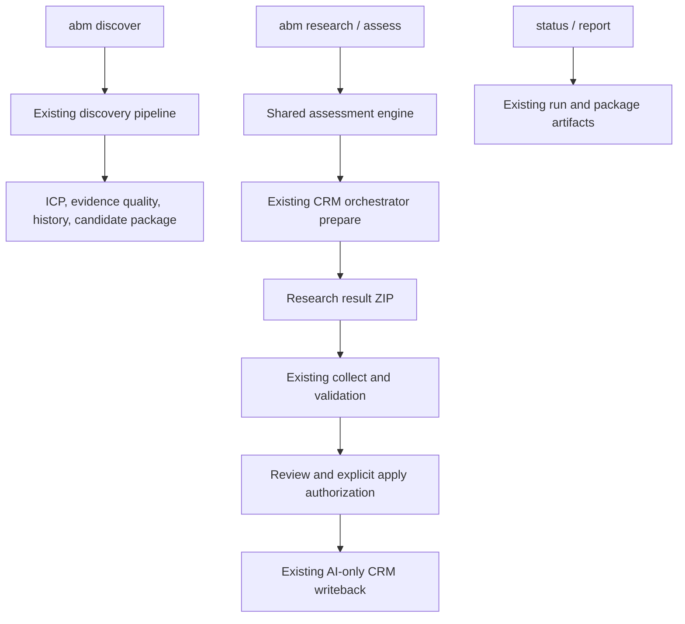

# Unified workflow and current boundaries

The `abm` command routes all standalone operations through the same services used by the workflow coordinator. The integrated package contract remains the existing orchestrator's four-assessment package so it preserves prompts, child-row identity, validation and writeback behavior.

The existing orchestrator resolves four linked organization assessment records as a unit and refuses missing/duplicate/unexpected templates. `abm assess organization` therefore invokes the existing all-four package preflight because the source package contract is inseparable. The current resolver does not cover product-linked assessments, and live metadata/identity rules could not be verified; product assessment execution fails closed. Creating missing product records is disabled, and no duplicate detection rule is invented here.

The source orchestrator updates only `ai_rating`, `ai_evidence_status`, `ai_confidence`, and `ai_supporting_evidence` on Draft assessment child rows. It preserves human review fields and does not update Organization financial values. Its package apply receipt records completion but the existing implementation does not perform a post-write read-back; ABM does not claim verification that the source function does not provide.

`abm run` presently prepares the organization research package. It cannot perform research itself, receive the returned ZIP, or skip the explicit review boundary. Product-specific standalone packages and a fully resumable account workflow remain pending a compatible source package contract and controlled CRM execution.
